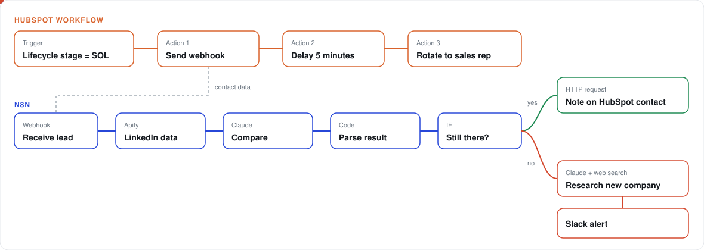
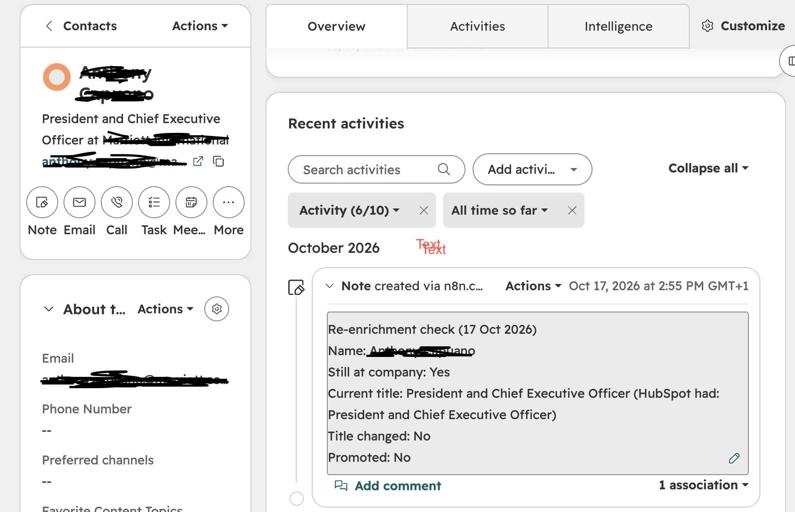
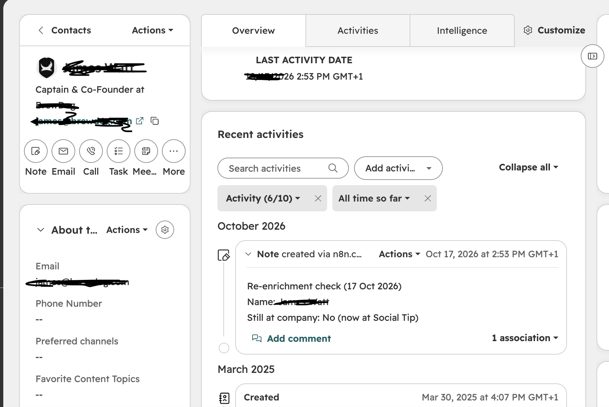
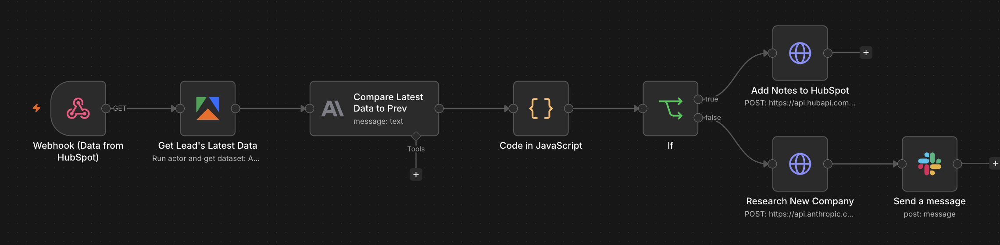
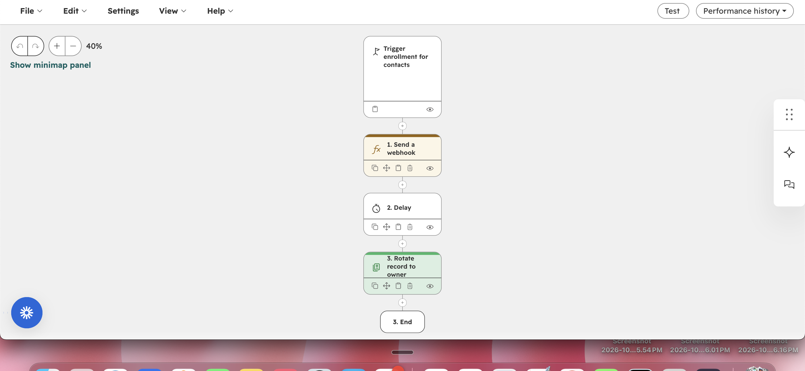

# HubSpot Lead Re-enrichment

## The problem

You hand a fresh SQL to your SDR. They research the account, write a thoughtful first email, maybe even call. Then the reply comes back: *"She left the company six months ago."* Or worse, nothing comes back at all, because the inbox is dead.

That one moment costs more than it looks:

- **Wasted time.** The SDR spent 20 minutes on research and outreach for someone who isn't there anymore.
- **A burned first touch.** The account now has an awkward, outdated email sitting in someone else's inbox.
- **Lost trust in the CRM.** After this happens a few times, reps stop believing what HubSpot tells them and start double-checking everything by hand.
- **Missed context.** Sometimes the person is still there but got promoted. The rep pitches a Manager when they're now talking to a Director, and the message lands at the wrong level.

The data was right when the lead came in. It just went stale while the lead was being nurtured, and nobody checks again before the handoff.

## The solution

I built a check that runs the moment a contact becomes a **Sales Qualified Lead**, before any rep sees it. It pulls the person's live LinkedIn profile, compares it with what HubSpot has on file, and acts on what it finds:

- **Still at the company:** a short note lands on the contact in HubSpot saying so, with their current title, whether the title changed, and whether they've been promoted. Then the lead is assigned to a rep as normal.
- **Changed companies:** it researches the company they've moved to (what it does, who it sells to) and posts a Slack alert, so the team knows before anyone reaches out.

It has been useful for catching the leads that would otherwise waste a rep's first touch, and for spotting promotions and title changes reps would want to know about.

| What can go wrong | What the workflow does |
|---|---|
| The person has left | Flags it, names where they work now, researches that company and alerts the team in Slack |
| The title is out of date | Compares the HubSpot title with LinkedIn, ignoring titles that are just reworded ("Purchasing Manager" = "Manager, Purchasing") |
| A promotion is missed | Flags it only if the new role is more senior and started in the last 12 months |
| Nobody re-checks | Runs automatically on every new SQL |

[**Watch it run**](https://claude.ai/artifact/CQ1tvV2CqrjXgGuoz2WTyy)

## How it works

**HubSpot workflow**
1. **Trigger:** lifecycle stage becomes Sales Qualified Lead.
2. **Send webhook** to n8n with the contact ID, name, company, job title and LinkedIn URL.
3. **Delay 5 minutes** while n8n does the check.
4. **Rotate record to owner** so the rep gets a lead that has already been verified.

**n8n workflow**
1. **Webhook** receives the contact from HubSpot.
2. **Apify** scrapes the person's live LinkedIn profile.
3. **Claude** compares HubSpot with LinkedIn: same person, still at the company, title changed, promoted. Only the 3 most recent roles are sent, which keeps token use low.
4. **Code node** turns Claude's JSON reply into separate fields and builds the HubSpot note.
5. **IF still at the company:** an HTTP request adds the note to the contact through the HubSpot API.
6. **IF they moved:** Claude researches the new company with Anthropic's web search and web fetch tools, and a Slack message goes out with who moved, where to, and what that company does.

## Proof of work

**Still at the company.** The title matches and there's no promotion, so the rep can go ahead with confidence.

**Changed companies.** The note says where they are now, so nobody emails the old address.

**The n8n workflow**

**The HubSpot workflow**

## Files

| File | Purpose |
|---|---|
| `prompt.md` | The comparison prompt, the parsing code, the HubSpot note request, the research request and the Slack message |
| `docs/how-it-works.svg` | Diagram of the HubSpot and n8n workflows |
| `docs/workflow-animation.html` | Source of the animated walkthrough |
| `images/` | Screenshots from the live workflows |

## Built with

[HubSpot Workflows](https://knowledge.hubspot.com/workflows) · [n8n](https://n8n.io) · [Apify](https://apify.com) · [Claude](https://www.anthropic.com/claude) (web search and web fetch tools) · [HubSpot CRM API v3](https://developers.hubspot.com/docs/api/crm/notes) · [Slack](https://slack.com)
